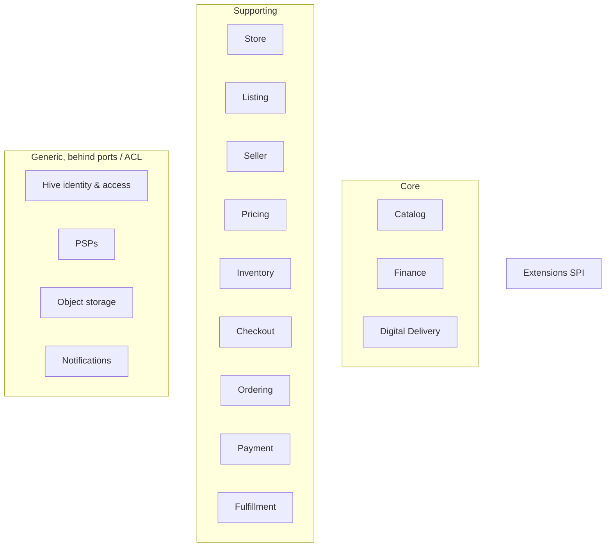
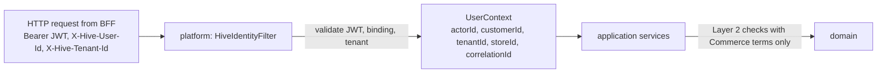

# Domain model

This is the entry point to the DDD design. The details live in `docs/domain/`:

| Document | Content |
|---|---|
| [Event storming](../domain/event-storming.md) | 8 flows (catalog setup, seller onboarding, purchase, fulfillment, digital delivery, refund, finance, mode upgrade) and hotspots |
| [Glossary](../domain/glossary.md) | Ubiquitous language, English and Persian, per context |
| [Context map](../domain/context-map.md) | Subdomains, relationships, integration patterns |
| [Aggregates](../domain/aggregates.md) | Aggregate catalogue with invariants; CheckoutProcess saga |
| [Domain events](../domain/domain-events.md) | Event catalogue, envelope and versioning rules |
| [ERD per context](erd.md) | Tables per schema |
| [ADR-0015](decisions/ADR-0015-ddd-model.md) | What changed from the §6.1 hypothesis and why |
| [ADR-0002](decisions/ADR-0002-modular-monolith.md) | Module, package, schema and boundary-test layout |

## Bounded contexts

## Shared kernel (kept deliberately small)

`Money`, `Currency` rules, `Quantity`, `LocalizedText`, `Period`, the typed-id base class, and the `DomainEvent` envelope. Nothing with business rules specific to one context goes here. Changes to the shared kernel need agreement across all contexts (review by an owner of each affected context).

## Value objects

Money, Quantity, Sku, Slug, LocalizedText, AttributeValue, Measurement, Dimensions, Weight, Address, TaxSnapshot, PriceSnapshot, CommissionRate, LicenseTerms, DownloadPolicy and Period are immutable, validated in their constructors, and compared by value. `AttributeValue` is a sealed hierarchy, one subtype per attribute type in §9, validated against an `AttributeDefinition` snapshot from the schema version.

## Domain services

`PriceCalculator` (Pricing), `OrderSplitter` (Ordering, used inside `Order.place`), `CommissionCalculator` (Finance), `SchemaValidator` (Catalog). No other domain services without a reason recorded in review.

## The anticorruption layer to Hive

The domain sees `CustomerId`, `ActorId`, `SellerId`, `StoreId` and `TenantId` only. It never sees JWTs, headers or OpenFGA terms.
