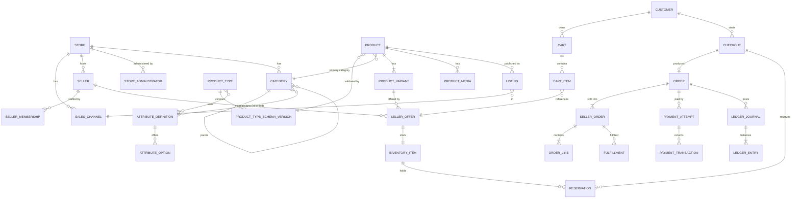

# Data model (Phase 1–2 core)

All tables carry `tenant_id`, `store_id`, `created_at`, `updated_at`, and `revision` where mutable. Catalog and configuration rows are archived, never deleted. Financial rows are immutable. The marketplace, digital and finance tables (Phases 3–4) are listed after the diagram.

Key constraints:

- `seller_offer`: `UNIQUE(store_id, seller_id, variant_id)`.
- `inventory_item.quantity_on_hand` is decremented only by a conditional update (`... WHERE available >= :qty`). Unique items have `quantity_on_hand = 1`.
- `reservation(expires_at)` is released by a scheduler and on payment failure.
- `payment_attempt`: `UNIQUE(idempotency_key)`, `UNIQUE(provider, provider_transaction_id)`.
- `payment_inbox`: `UNIQUE(provider, provider_event_id)`.
- `ledger_entry`: append-only trigger; each journal balances per currency.
- `order_line` stores snapshots: product title, variant attributes, unit price, tax, discount, seller id/name, listing id.
- `customer(hive_user_id UNIQUE per tenant)`, `identity_binding(issuer, subject) → hive_user_id`.
- Outbox: `outbox_event(id, aggregate_type, aggregate_id, type, payload jsonb, occurred_at, published_at)`.

Later phases add: `commission_rule`, `commission_record`, `settlement`, `payout` (Phase 4); `digital_asset`, `digital_content_version`, `product_digital_asset`, `license`, `download_entitlement`, `download_access_log`, `upload_session` (Phase 3); `seller_application`, `moderation_case` (Phase 4).
