# ERD per bounded context

One PostgreSQL schema per context (ADR-0002); no cross-schema foreign keys (references are ids, shown as `ref`). Every table has `tenant_id`, `store_id`, `created_at`; mutable roots have `revision` and `updated_at`. Catalog and configuration rows are archived (`archived_at`), never deleted. Financial rows are immutable.

## store

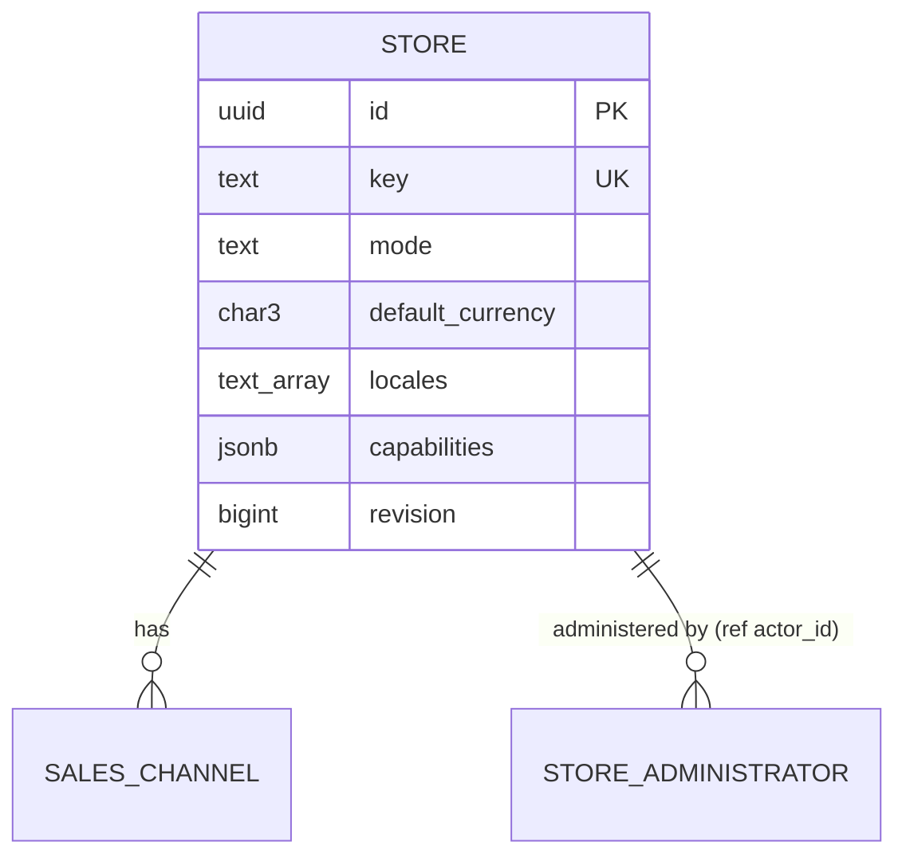

## catalog

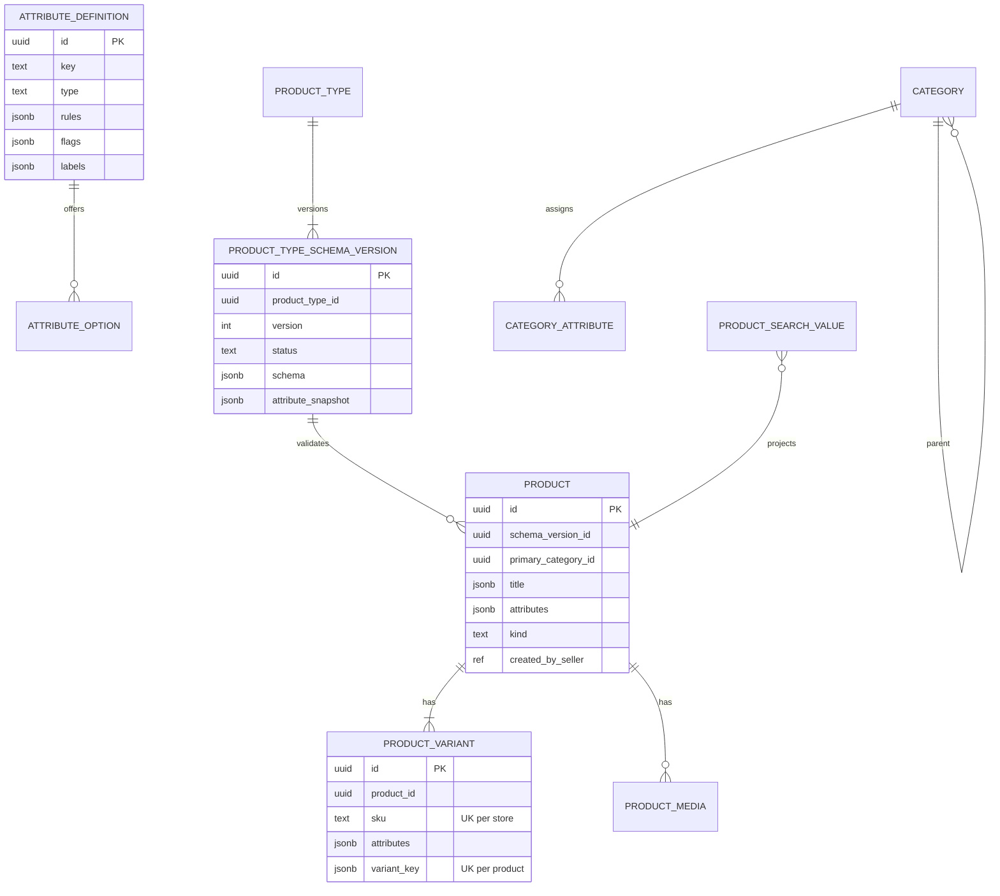

## listing

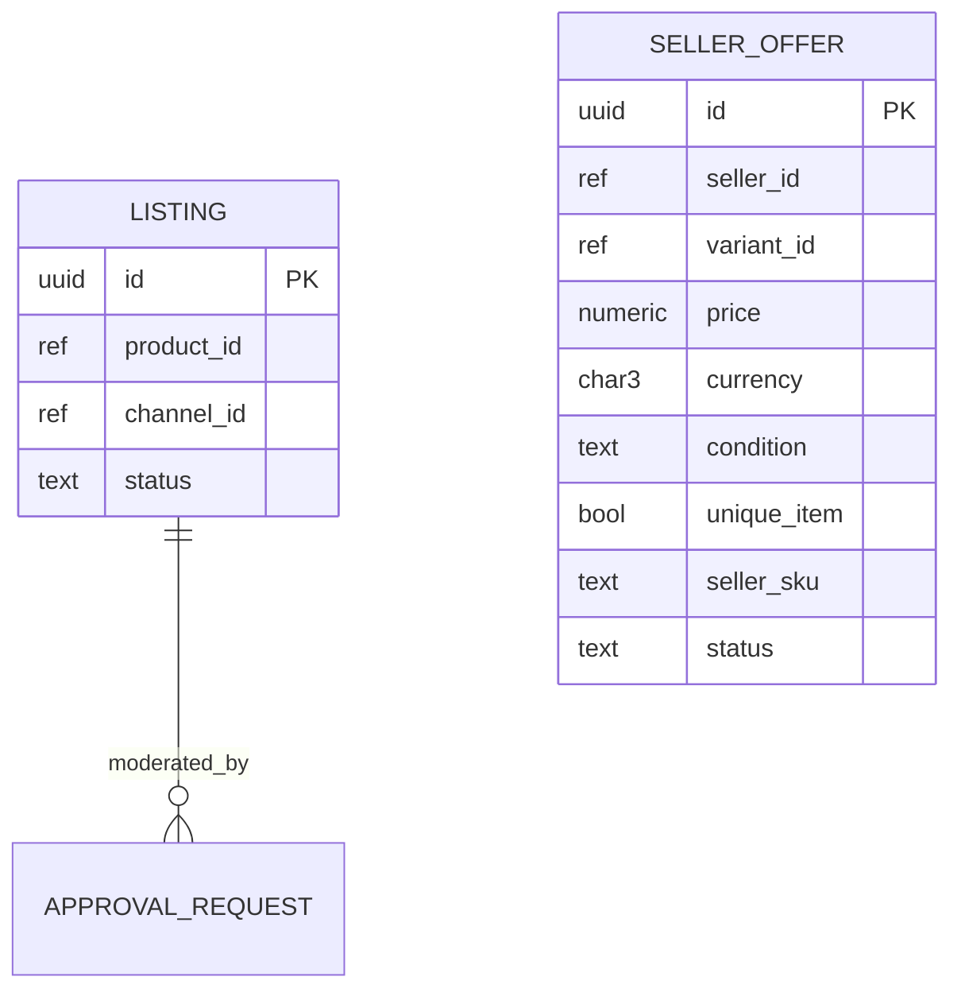

`seller_offer`: unique `(store_id, seller_id, variant_id)` and `(store_id, seller_id, seller_sku)`.

## seller

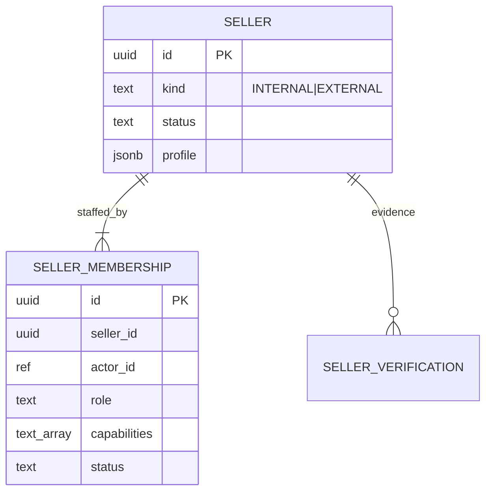

## pricing

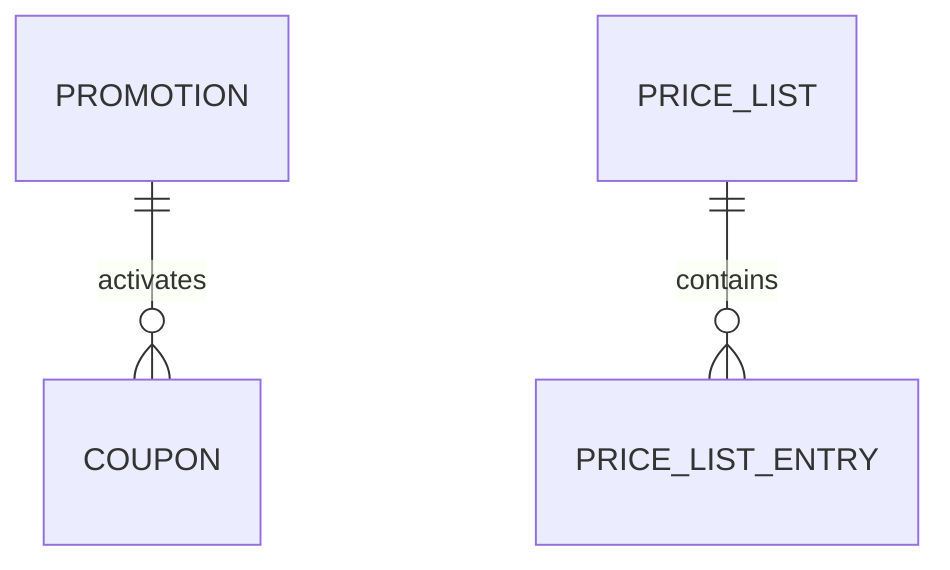

## inventory

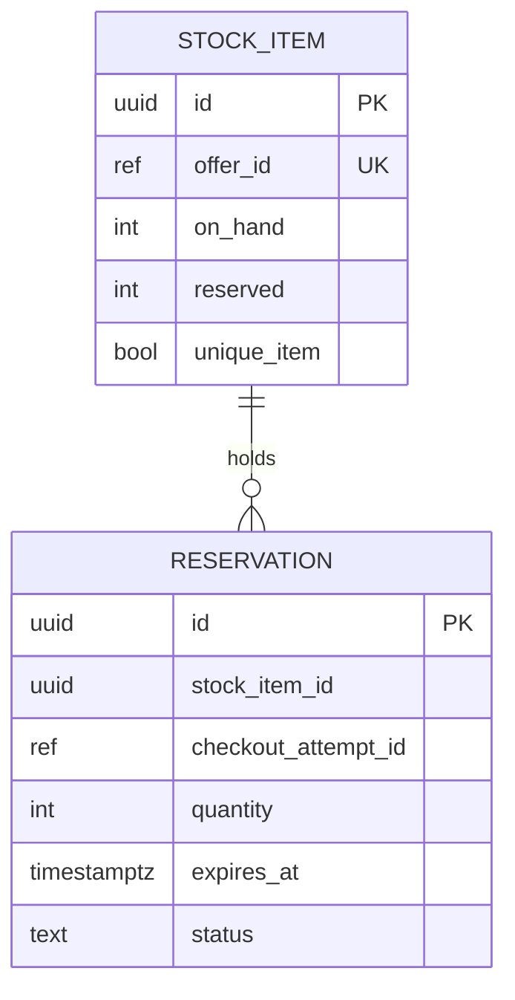

Check constraints: `reserved >= 0`, `on_hand >= reserved`, `NOT unique_item OR on_hand <= 1`. `reserve` is `UPDATE ... SET reserved = reserved + :q WHERE id = :id AND on_hand - reserved >= :q` (row count 0 = rejected).

## checkout

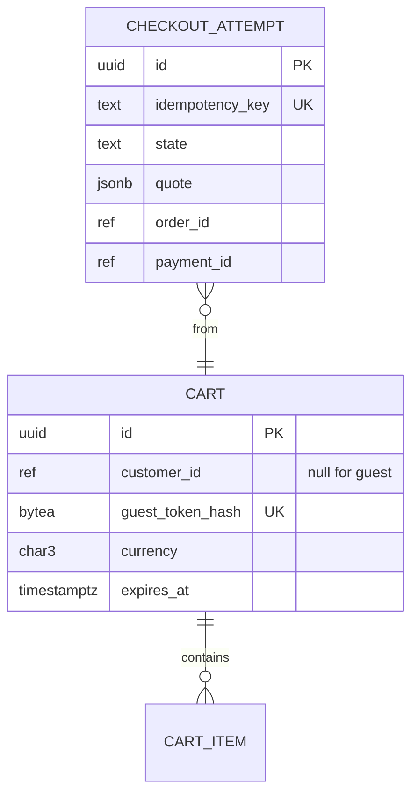

## ordering

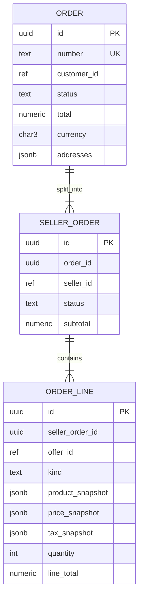

## payment

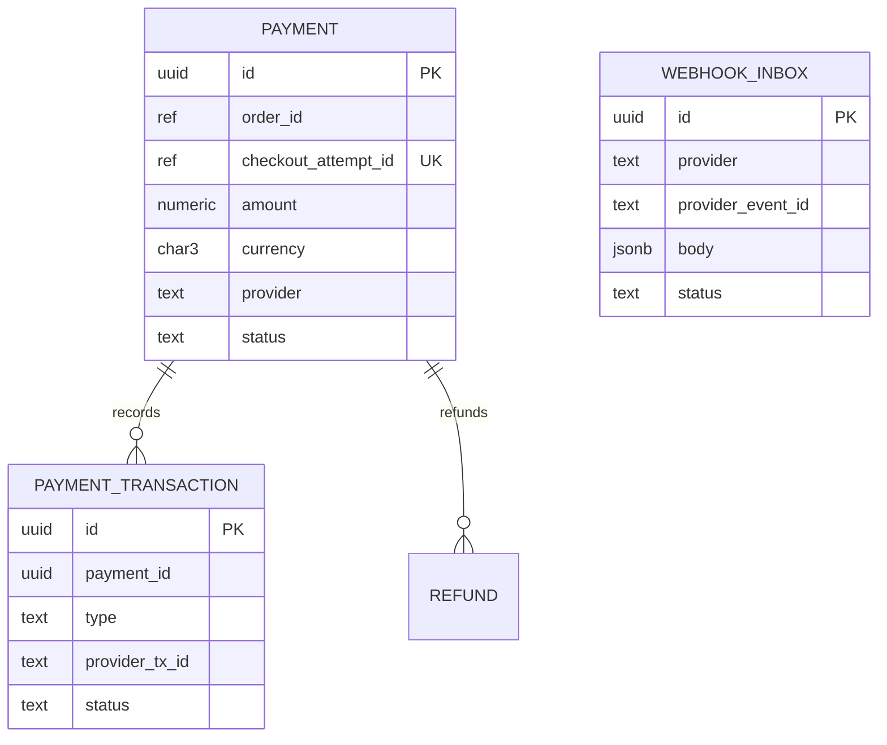

Unique: `payment_transaction(provider, provider_tx_id)`, `webhook_inbox(provider, provider_event_id)`.

## fulfillment

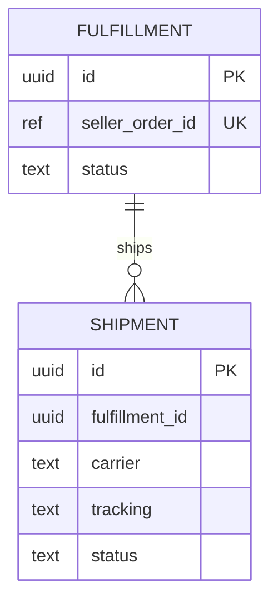

## digital

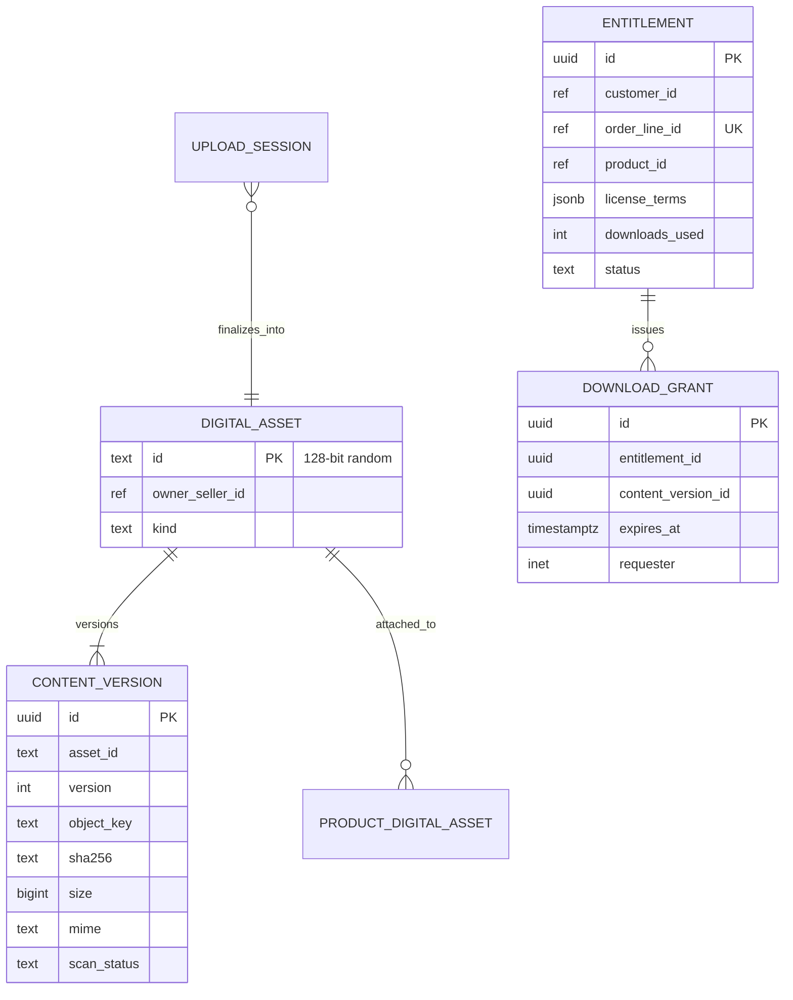

## finance

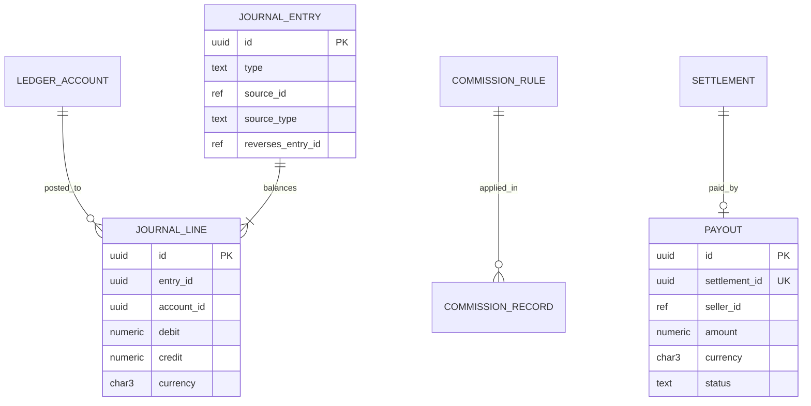

`journal_entry` and `journal_line` are append-only (UPDATE/DELETE blocked by trigger). A deferred constraint trigger checks Σ debit = Σ credit per currency per entry at commit.

## platform (technical)

`outbox_event`, `processed_event(consumer, event_id)`, `identity_binding(issuer, subject → hive_user_id)`, `business_audit_event` (append-only), `extension_data`.
