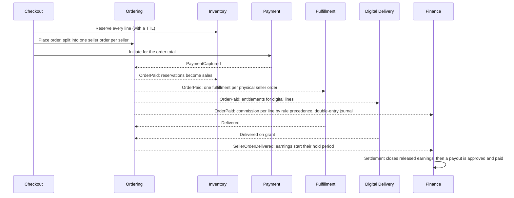

# Key flows

The purchase sequence and two-layer authorization are in the [overview](overview.md). The product data model is in the
[ERD](erd.md).

## Payment verification

A browser redirect is never proof of payment. Two independent paths reach the same idempotent confirmation.

```mermaid
sequenceDiagram
  actor Shopper
  participant Store as Storefront (same origin)
  participant BFF as Hive BFF
  participant Engine as Commerce engine
  participant PSP as Payment provider

  Shopper->>Store: Checkout
  Store->>BFF: POST /api/routes/commerce/v1/shop/checkouts (idempotency key)
  BFF->>Engine: With token and operation headers
  Engine->>PSP: Initiate payment
  PSP-->>Engine: Reference and redirect URL
  Engine-->>Shopper: redirectUrl
  Shopper->>PSP: Pays on the provider's page
  PSP-->>Shopper: Redirect to the return page
  Shopper->>Store: GET /{locale}/checkout/return
  Store->>BFF: POST /v1/shop/payments/{id}/verify
  BFF->>Engine: Forwarded
  Engine->>PSP: Verify (server to server)
  PSP-->>Engine: Captured or not
  Engine-->>Store: Status decided by the server
  PSP->>Engine: Signed webhook on /hooks/payments/{provider}, never through the BFF
  Note over Engine: Signature checked, stored in the inbox, replays ignored.<br/>Whichever path comes first confirms; the other changes nothing.
  Engine->>Engine: PaymentCaptured, then OrderPaid through the outbox
```

## Digital upload and download

Files go directly to storage. They never pass through the BFF, and paid content never appears in a public response.

```mermaid
sequenceDiagram
  actor Seller
  actor Buyer
  participant BFF as Hive BFF
  participant Engine as Commerce engine
  participant S3 as Object storage

  Seller->>BFF: POST /v1/seller/assets/{id}/uploads (type, size, SHA-256)
  BFF->>Engine: Forwarded; Commerce checks assets.manage
  Engine-->>Seller: Signed form limited to that type and size
  Seller->>S3: POST the file with the signed form
  Seller->>BFF: POST .../uploads/{uploadId}/finalize
  BFF->>Engine: Forwarded
  Engine->>S3: Read the object
  Note over Engine: Checks checksum, real file type and malware scan.<br/>Only then does it become a content version.
  Buyer->>BFF: POST /v1/shop/library/{entitlementId}/downloads
  BFF->>Engine: Forwarded
  Note over Engine: Checks owner, revocation and download limit; logs the grant
  Engine-->>Buyer: JSON with a short-lived signed URL (or inline text for a prompt)
  Buyer->>S3: GET the signed URL
```

## Multi-seller order processing

One cart can buy from several sellers. Each seller sees only its own part.


