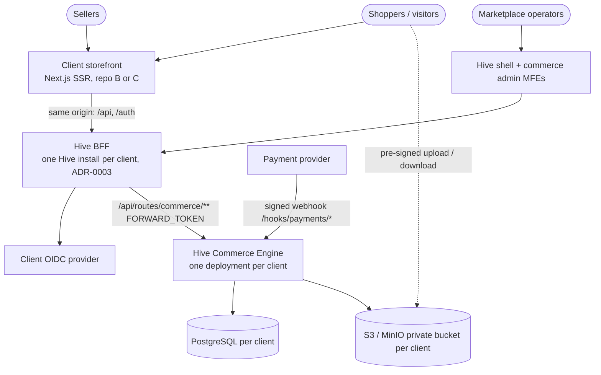
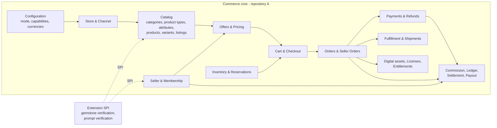
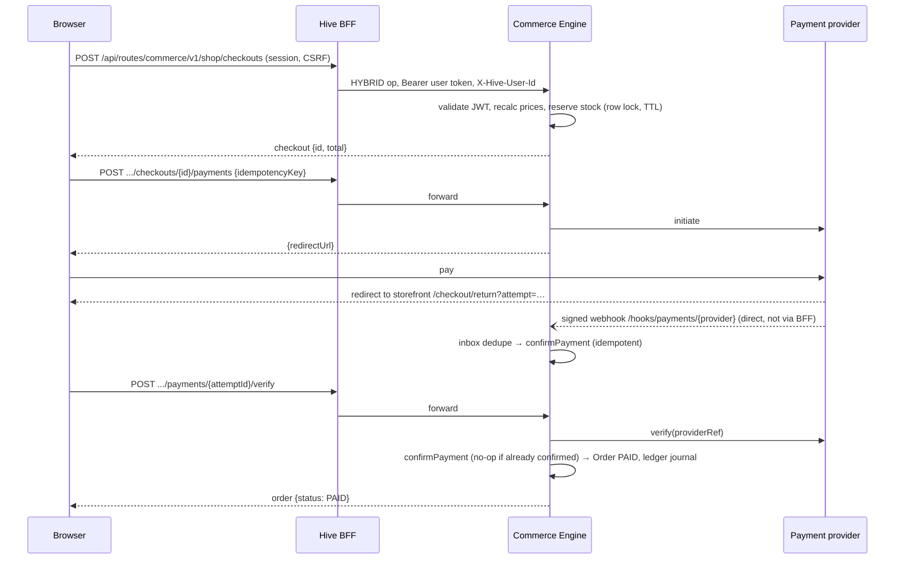
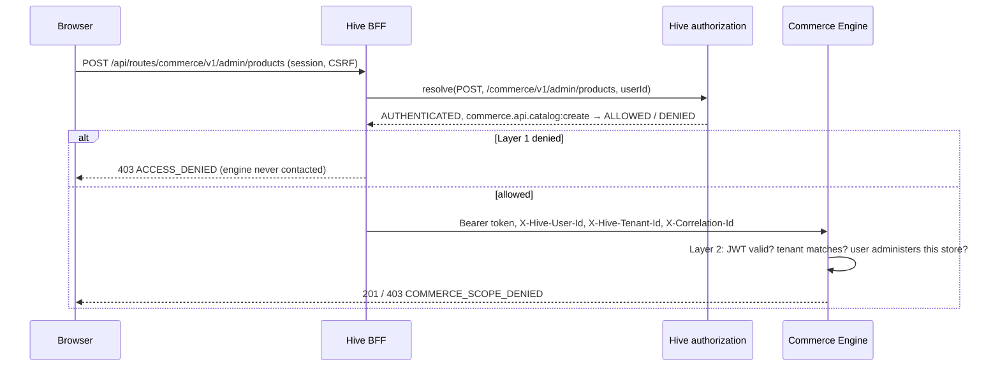

# Architecture overview

> Platform owns capabilities. Solution owns business. Consumer owns presentation.

Hive is the platform. Hive Commerce Engine (this repository) is a reusable solution layer. Each client repository (gemstone-commerce, aidastoor-commerce) is a solution plus consumer built on it. Hive facts used here are verified in [hive-integration](hive-integration.md).

## System context

## Bounded contexts (context map)

Relationships: Catalog is upstream of Offers, Cart and Orders, which consume snapshots (published language: `ListingSnapshot`, `PriceQuote`). Orders publish `OrderPaid`, `OrderLineRefunded` and similar events through the transactional outbox; Finance, Fulfillment and Digital conform to those events.

## Purchase sequence (physical, single vendor)

## Authentication and two-layer authorization

Further diagrams are produced in the phase that implements them: digital upload/download (Phase 3), multi-seller order processing (Phase 4).

## Deployment per client

One Hive install (gateway/BFF, authorization, OpenFGA, PostgreSQL, Redis) + one engine container (API port on the private network, webhook port exposed only via the `/hooks/` ingress rule) + PostgreSQL + S3 bucket + the client storefront (Next.js server, which proxies `/api`, `/auth`, `/oauth2` and `/login/oauth2` to the BFF on the same origin).
