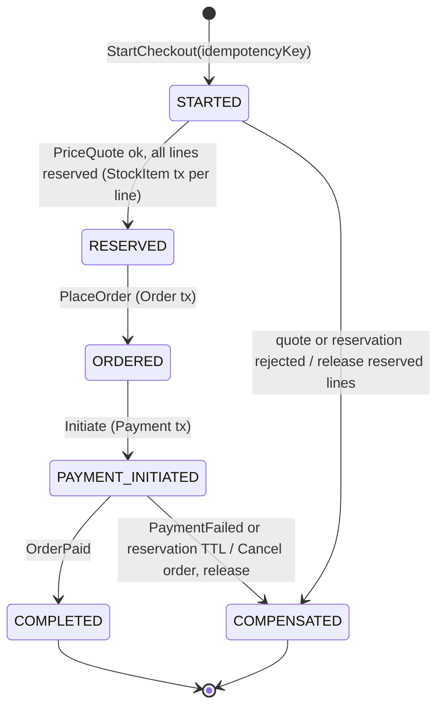

# Aggregate catalogue

Rules for every aggregate: typed ids; references to other aggregates by id only; one aggregate modified per transaction (the CheckoutProcess saga is the coordinated exception, see below); `tenantId`, `storeId` and an optimistic `revision` on every root; invariants enforced inside the aggregate and covered by aggregate-level unit tests (no Spring, no database).

| Context | Aggregate root (entities inside) | Invariants | Commands | Events |
|---|---|---|---|---|
| Store | **Store** (SalesChannel) | Exactly one active default currency; mode change SINGLE→MULTI/HYBRID allowed; downgrade rejected while external sellers are active | `BootstrapStore`, `ChangeCommerceMode`, `UpdateSettings`, `OpenChannel` | `StoreBootstrapped`, `CommerceModeChanged`, `StoreSettingsChanged` |
| Catalog | **AttributeDefinition** (AttributeOption) | Key unique per store; type immutable once used by a published schema; options archived, never deleted | `DefineAttribute`, `AddOption`, `ArchiveAttribute` | `AttributeDefined`, `AttributeArchived` |
| Catalog | **ProductType** (SchemaVersion) | Published version immutable; a new version is a copy plus changes; variant-defining attributes are ENUM/MULTI_SELECT/COLOR | `CreateProductType`, `DraftSchemaVersion`, `PublishSchemaVersion` | `ProductTypeSchemaPublished` |
| Catalog | **Category** | No cycles; depth ≤ configured maximum; slug unique among siblings; archive only when no active children | `CreateCategory`, `MoveCategory`, `AssignAttributes`, `ArchiveCategory` | `CategoryCreated`, `CategoryMoved`, `CategoryArchived` |
| Catalog | **Product** (ProductVariant, Media) | Attribute values valid against the referenced schema version; variant-defining combinations unique; at least one variant (implicit if none defined); variant SKU unique per store (repository-checked, unique index) | `CreateProduct`, `UpdateProduct`, `AddVariant`, `MigrateToSchemaVersion`, `ArchiveProduct` | `ProductCreated`, `ProductUpdated`, `ProductArchived` |
| Listing | **Listing** (ApprovalRequest) | Publish only an approved product in an active store/channel; one active listing per product and channel | `SubmitForApproval`, `Approve`, `Reject`, `Publish`, `Unpublish` | `ApprovalRequested`, `ListingApproved`, `ProductPublished`, `ProductUnpublished` |
| Listing | **SellerOffer** | Price > 0 in store currency; seller active (checked via Seller's published API at command time); unique-item offers have quantity ≤ 1; `sellerSku` unique per seller | `CreateOffer`, `ChangePrice`, `WithdrawOffer` | `OfferCreated`, `OfferPriceChanged`, `OfferWithdrawn` |
| Seller | **Seller** (SellerMembership, Verification) | applied → verified → active ⇄ suspended (→ closed); always ≥ 1 active owner membership once active; the internal seller cannot be suspended | `ApplyAsSeller`, `VerifySeller`, `ApproveSeller`, `SuspendSeller`, `GrantMembership`, `RevokeMembership` | `SellerApplied`, `SellerVerified`, `SellerApproved`, `SellerSuspended`, `MembershipGranted` |
| Pricing | **Promotion** (Coupon) | Valid period; currency matches the store; non-stackable rules flagged; coupon usage ≤ limit | `CreatePromotion`, `IssueCoupon`, `RedeemCoupon` | `PromotionActivated`, `CouponRedeemed` |
| Pricing | **PriceList** | One price per offer per list; positive amounts | `SetPrice` | `PriceListChanged` |
| Inventory | **StockItem** (Reservation) | `available = onHand − reserved ≥ 0`; `unique ⇒ onHand ≤ 1`; each reservation released or consumed exactly once; TTL on every reservation | `OpenStockItem`, `Adjust`, `Reserve`, `Release`, `Consume`, `Expire` | `StockReserved`, `ReservationReleased`, `ReservationExpired`, `StockConsumed` |
| Checkout | **Cart** (CartItem) | Lines reference offers by id; quantity within limits and ≤ 1 for unique items; one currency | `AddItem`, `ChangeQuantity`, `RemoveItem`, `MergeInto` | `CartItemAdded`, `CartMerged` |
| Checkout | **CheckoutAttempt** | One per idempotency key; state machine `STARTED → RESERVED → ORDERED → PAYMENT_INITIATED → COMPLETED / COMPENSATED` | driven by CheckoutProcess | `CheckoutStarted`, `CheckoutCompensated` |
| Ordering | **Order** (OrderLine, SellerOrder) | Snapshots immutable after placement; total = Σ lines (per currency); allowed transitions only; seller order states derived per seller | `PlaceOrder`, `MarkPaid`, `Cancel`, `MarkSellerOrderShipped`, `RecordLineRefund` | `OrderPlaced`, `OrderPaid`, `OrderCancelled`, `SellerOrderShipped`, `SellerOrderDelivered`, `OrderLineRefunded` |
| Payment | **Payment** (PaymentTransaction, Refund) | Amount and currency equal the order total; capture idempotent per provider transaction id; `Σ refunds ≤ captured` | `Initiate`, `Confirm(verified)`, `Fail`, `RequestRefund`, `CompleteRefund` | `PaymentInitiated`, `PaymentCaptured`, `PaymentFailed`, `RefundCompleted` |
| Payment | **WebhookInboxEntry** | Unique (provider, providerEventId); processed once | `Receive`, `MarkProcessed` | — (internal) |
| Fulfillment | **Fulfillment** (Shipment) | Belongs to one seller order; `PENDING → PACKED → SHIPPED → DELIVERED` or `→ FAILED/RETURNED` | `CreateShipment`, `MarkShipped`, `ConfirmDelivery` | `SellerOrderShipped`, `SellerOrderDelivered` |
| Digital Delivery | **DigitalAsset** (ContentVersion) | Versions immutable; content attached only after finalize (size, checksum, MIME, scan); owner seller fixed | `RequestUpload`, `FinalizeUpload`, `AttachToProduct` | `ContentVersionAdded`, `AssetAttached` |
| Digital Delivery | **Entitlement** (DownloadGrant) | Granted only for a paid order line; download count ≤ policy limit; no grant after revocation | `Grant`, `IssueDownload`, `Revoke` | `EntitlementGranted`, `DownloadGranted`, `EntitlementRevoked` |
| Finance | **CommissionRule** | Precedence product > seller > category > store; rate 0–100 % with defined rounding; effective periods do not overlap at the same scope | `DefineRule`, `RetireRule` | — |
| Finance | **CommissionRecord** | One per seller order version; reversal record for refunds | `Calculate`, `Reverse` | `CommissionCalculated` |
| Finance | **JournalEntry** | Σ debits = Σ credits per currency; append-only; corrections are reversing entries | `Post` | `JournalPosted` |
| Finance | **Settlement** | One open settlement per seller and period; closed once | `Close` | `SettlementClosed` |
| Finance | **Payout** | Amount ≤ settled available balance; approved once; never duplicated (unique per settlement) | `Request`, `Approve`, `MarkPaid`, `Reject` | `PayoutRequested`, `PayoutApproved`, `PayoutPaid` |

## CheckoutProcess (process manager / saga)

Every step is idempotent and keyed by the `CheckoutAttempt` id, so a retry after a crash resumes from the persisted state. The unique-item guarantee rests on `StockItem.reserve`, a conditional update (`reserved + q ≤ on_hand`) inside the StockItem transaction. It does not depend on saga ordering.
