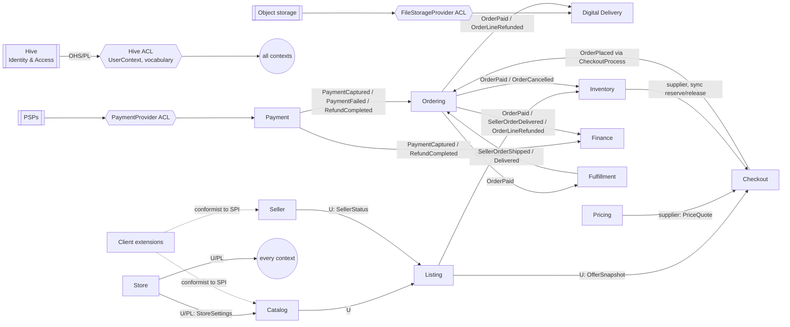

# Context map

Subdomains and contexts follow §6.1 of the master prompt, with the corrections from [event storming](event-storming.md) recorded in [ADR-0015](../architecture/decisions/ADR-0015-ddd-model.md).

## Subdomains

| Type | Subdomain | Context(s) |
|---|---|---|
| Core | Configurable Catalog | Catalog |
| Core | Marketplace Finance | Finance |
| Core | Digital Entitlement & Delivery | Digital Delivery |
| Supporting | Listing & Offer, Seller, Pricing & Promotion, Inventory, Cart & Checkout, Ordering, Fulfillment, Store Configuration | Listing, Seller, Pricing, Inventory, Checkout, Ordering, Fulfillment, Store |
| Generic | Identity & Access | **Hive**, reached through the Hive ACL |
| Generic | PSPs, object storage, notifications, tax/shipping carriers, search engine | adapters behind ports |

## Map

## Relationship table

| Upstream | Downstream | Pattern | Contract | Sync / async |
|---|---|---|---|---|
| Hive | all | Open Host Service → **ACL** in `platform` | `UserContext`, `CustomerId`, `ActorId` | per request |
| Store | all | Upstream / published language | `StoreSettings` (mode, currency, locales, capabilities) | sync query, cached |
| Catalog | Listing | Customer–supplier | `ProductSummary`, `VariantRef` | sync query |
| Seller | Listing, Finance | Customer–supplier | `SellerStatus`, `SellerRef` | sync query + `SellerSuspended` event |
| Listing | Checkout | Customer–supplier | `OfferSnapshot` (price basis, seller, kind) | sync query |
| Listing | Inventory | Event | `OfferCreated`, `OfferWithdrawn` | async (outbox) |
| Pricing | Checkout | Supplier | `PriceQuote` | sync |
| Inventory | Checkout | Supplier | `reserve` / `release` | **sync, inside CheckoutProcess** |
| Checkout | Ordering | Process manager | `PlaceOrder` command with snapshots | sync step of the saga |
| Payment | Ordering, Finance | Events | `PaymentCaptured`, `PaymentFailed`, `RefundCompleted` | async |
| Ordering | Inventory, Fulfillment, Digital Delivery, Finance | Events | `OrderPaid`, `OrderCancelled`, `OrderLineRefunded`, `SellerOrderDelivered` | async |
| Fulfillment | Ordering | Events | `SellerOrderShipped`, `SellerOrderDelivered` | async |
| Extension SPI | Catalog, Seller, Listing | Conformist (clients conform to the SPI) | `commerce-spi` | in-process |

## Changes from the §6.1.3 hypothesis

1. **Digital Delivery listens only to Ordering** (`OrderPaid`, `OrderLineRefunded`), not to Payment, so there is a single trigger per grant or revocation.
2. **Finance listens to both.** From Payment it takes cash movements (`PaymentCaptured` → cash in, `RefundCompleted` → cash out). From Ordering it takes allocation (`OrderPaid` → seller payable + commission, `SellerOrderDelivered` → release hold).
3. **Listing → Inventory** via `OfferCreated` (a stock item is opened per offer), which the hypothesis did not show.
4. The Hive ACL is a shared technical module (`platform`), not a bounded context.
